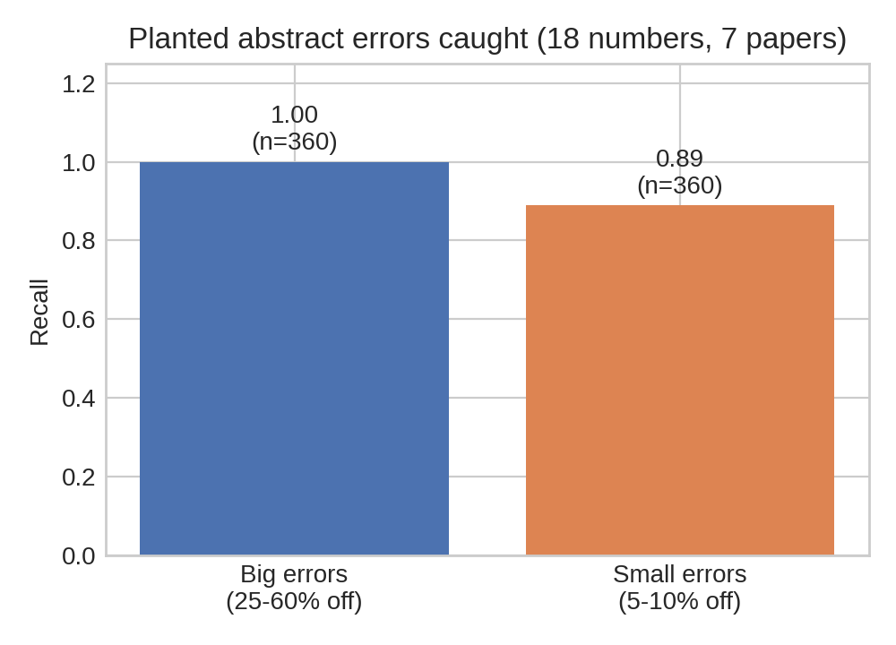

# numcheck

Do the numbers in a paper's abstract actually appear in its results?

A small Python tool that compares the numbers quoted in a paper's abstract with
the numbers in the rest of the paper, and flags the ones it cannot find.
Built for the OSI Hackathon 2026.

## Problem
An abstract is the part of a paper most people read, and it is full of headline
numbers: efficiency, bandgap, voltage, loss. Readers, reviewers and automated
tools take these numbers as the paper's result. But the abstract is written
separately from the results section, and a number can end up different in the
two places (a typo, an old draft, a rounding slip). Checking this by hand means
reading the whole paper, so it rarely gets done.

## Motivation
In physical sciences, one headline number often decides whether someone reads a
paper, cites it, or copies its value into a database or a model. A wrong digit
in an abstract travels further than a wrong digit buried in a table. I wanted to
see how far a very simple, transparent check could go before reaching for a
large language model, and to measure honestly where it breaks.

## Solution
numcheck reads the abstract and the body and asks one question per number: does
this value appear again in the body?

1. Pulls every number with a unit from the abstract (%, eV, V, mA/cm2, nm, ...).
2. Attaches the nearest keyword ("efficiency", "bandgap", ...).
3. Looks for the same value in the body, with the same unit, allowing for
   rounding (14 in the abstract, 14.1 in the body is fine).
4. If the body discusses that quantity but never uses that number, it flags it
   for a human to look at.

It does not decide who is right. It points a reviewer to the numbers that are
worth a second look.

## Small example
Toy abstract: "...an efficiency advantage of up to 22% absolute..."
Toy body: "...the efficiency advantage is 14.1% absolute... tandem gain reaches
13.0%..."
The body talks about this quantity but never uses 22, so numcheck flags 22%.
With "up to 14%" in the abstract it passes, because 14 matches 14.1 within
rounding. (This toy case is also in the self-test inside the code.)

## How I tested it
I planted wrong numbers in abstracts myself and counted how many got flagged.

- 8 arXiv papers loaded, 7 had checkable abstract numbers (18 numbers total).
- Each number was changed 20 times with a random wrong value.

| Planted error size | Caught | Recall |
|---|---|---|
| Big (25 to 60 percent off) | 360 / 360 | 1.00 |
| Small (5 to 10 percent off) | 320 / 360 | 0.89 |

The 20 repeats are on the same 18 numbers, so this is not 360 independent tests.

## What I found
**Misses.** All 40 misses came from one paper (1910.07422). Its body lists many
nearby bandgap values (1.4, 1.5, 1.6, 1.7 eV), so a wrong number often lands on
another real value and slips through. The checker is only as strict as the
paper is specific.

**False alarms.** On unchanged abstracts the tool flagged 3 of the 18 numbers
(17 percent), all in paper 1801.02941. I opened the paper to check. The
abstract's 19 percent efficiency and two 35 percent losses are not written in
the body text. They appear in Figure 6: the device efficiency is 19.23 to 19.38
percent, and the loss pie chart shows 35 percent for recombination and 35
percent for series resistance (plus 25 percent optical and 5 percent shunt). My
script reads text only, so it cannot see them. I count these as false alarms.
Numbers that only live in figures get flagged.

## Limits
- Small test: 18 numbers from 7 papers.
- The errors are planted at random, not real author mistakes. This does not
  measure how well it finds real mistakes.
- It reads PDF text. Numbers inside figures are invisible to it, and tables are
  not parsed separately.
- The keyword is a guess from nearby words. One "95%" was labelled "bandgap".
- No LLM is used. Claims written in words are not checked.

## Who could use it (not tested yet)
Ideas, not results: a reviewer doing a last pass, an author before posting a
preprint, or a pipeline that pulls numbers from papers into a dataset.

## Run it
    pip install requests pymupdf

    from numcheck import load_arxiv, check
    abstract, body = load_arxiv("1706.08610")
    print(check(abstract, body))

## Files
- `numcheck.py` the checker, the error planting and the evaluation code
- `numcheck.ipynb` the full experiment (paper loading, error planting, figure)
- `results.png` the recall chart above

## Next
- Parse tables and read figures instead of flat text only.
- Add an LLM step for claims in words ("outperforms the baseline").
- Test on more papers and on real corrections published by journals.

Built for the OSI Hackathon 2026. I used an AI tool to help write and debug the
code. I ran the experiments and checked the flagged paper myself.
